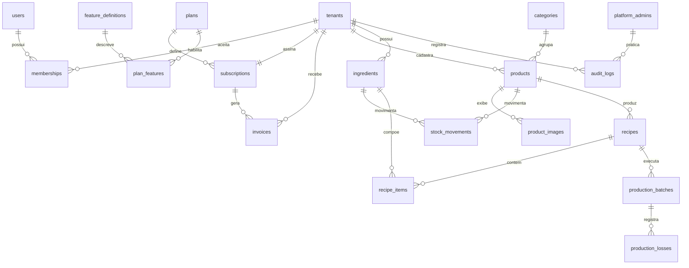

# Fase 01 — Modelo de Dados Inicial

> Modelo **inicial** da fundação. Tabelas de módulos específicos serão refinadas nas fases 03–07,
> sempre por migration versionada. Convenções: `id` UUID v7, dinheiro em `*_cents` (inteiro),
> datas `timestamptz`, `created_at`/`updated_at` em todas as tabelas mutáveis.

## 1. Diagrama de entidades (núcleo)



## 2. Núcleo: plataforma e acesso

### `tenants`
| Coluna | Tipo | Notas |
|---|---|---|
| id | uuid PK | v7 |
| slug | text UNIQUE | usado na vitrine `/slug` |
| legal_name | text | razão social |
| trade_name | text | nome fantasia |
| document | text | CNPJ/CPF, criptografado em repouso pelo provedor |
| email, phone, whatsapp | text | contato |
| logo_key | text | chave no R2 (não URL pública) |
| brand_color | text | hex validado |
| timezone | text | default `America/Sao_Paulo` |
| status | text | `ACTIVE`, `SUSPENDED`, `CLOSED` (administrativo) |
| created_at, updated_at, deleted_at | timestamptz | |

### `users`
`id`, `email` (UNIQUE, normalizado), `password_hash`, `name`, `email_verified_at`,
`two_factor_secret` (cifrado), `status` (`ACTIVE`/`DISABLED`), `last_login_at`, timestamps.

### `memberships`
`id`, `user_id` FK, `tenant_id` FK, `role` (`OWNER`/`MANAGER`/`STAFF`), `status`,
`invited_by`, `accepted_at`, timestamps.
`UNIQUE (user_id, tenant_id)` e índice `(tenant_id, role)`.
Um usuário pode participar de mais de uma padaria (ex.: contador), mas toda requisição escolhe
**um** tenant ativo.

### `sessions`
Sessão em banco para permitir revogação: `id`, `user_id` (ou `platform_admin_id`), `token_hash`,
`expires_at`, `ip`, `user_agent`, `revoked_at`. Nunca guardar o token em claro.

### `platform_admins`
`id`, `user_id`, `role` (`OWNER`/`SUPPORT`), `mfa_required` (default true), `is_active`,
`last_mfa_at`, timestamps. Tabela separada de propósito: privilégio de plataforma não se
mistura com vínculo de padaria.

### `invitations`
`id`, `tenant_id`, `email`, `role`, `token_hash`, `expires_at`, `accepted_at`, `created_by`.

## 3. Catálogo e vitrine

### `categories`
`id`, `tenant_id`, `name`, `slug`, `sort_order`, `is_active`, timestamps.
`UNIQUE (tenant_id, slug)` e `UNIQUE (tenant_id, id)` (necessário para FK composta).

### `products`
| Coluna | Tipo | Notas |
|---|---|---|
| id | uuid PK | |
| tenant_id | uuid NOT NULL | |
| category_id | uuid | FK composta `(tenant_id, category_id)` |
| name, slug | text | `UNIQUE (tenant_id, slug)` |
| description | text | |
| price_cents | integer | `CHECK >= 0` |
| unit | text | `UN`, `KG`, `CX`... |
| sku | text | opcional |
| image_key | text | capa no R2 |
| is_active | boolean | aparece no catálogo interno |
| is_available | boolean | aparece na vitrine |
| track_stock | boolean | liga baixa automática na venda (fase futura) |
| min_stock | numeric | alerta |
| created_at, updated_at, deleted_at | timestamptz | soft delete preserva histórico |

### `product_images`
`id`, `tenant_id`, `product_id`, `storage_key`, `alt`, `sort_order`, `created_at`.
FK composta por tenant. Limite de imagens validado no servidor.

### `product_price_history`
`id`, `tenant_id`, `product_id`, `old_price_cents`, `new_price_cents`, `changed_by`, `created_at`.
Alimentado por trigger ou pelo service; nunca editável.

## 4. Estoque

Modelo de **livro-razão**: o saldo é consequência dos movimentos, nunca um número digitado.

### `ingredients`
`id`, `tenant_id`, `name`, `unit`, `cost_per_unit_cents`, `min_stock`, `current_stock`,
`supplier`, `is_active`, timestamps. `UNIQUE (tenant_id, name, unit)`.

### `stock_movements` (imutável)
| Coluna | Tipo | Notas |
|---|---|---|
| id | uuid PK | |
| tenant_id | uuid NOT NULL | |
| item_type | text | `PRODUCT` ou `INGREDIENT` |
| item_id | uuid | referência polimórfica validada no service |
| movement_type | text | `IN`, `OUT`, `ADJUSTMENT`, `LOSS`, `PRODUCTION_CONSUMPTION`, `PRODUCTION_OUTPUT` |
| quantity | numeric(12,3) | sempre positivo; o tipo dá o sinal |
| unit_cost_cents | integer | custo no momento |
| reason | text | obrigatório em `ADJUSTMENT`/`LOSS` |
| reference_type, reference_id | text, uuid | ex.: `production_batch` |
| created_by | uuid | usuário responsável |
| created_at | timestamptz | |

Sem `updated_at` e sem `deleted_at`: correção é um novo movimento de ajuste.
Índice `(tenant_id, item_type, item_id, created_at DESC)`.

### `stock_balances`
`tenant_id`, `item_type`, `item_id`, `quantity`, `updated_at`, PK composta.
Atualizado **na mesma transação** do movimento, com `UPDATE ... RETURNING` e verificação de
saldo negativo quando a política exigir.

## 5. Produção

### `recipes` (ficha técnica)
`id`, `tenant_id`, `product_id`, `name`, `yield_quantity`, `yield_unit`, `notes`,
`is_active`, timestamps.

### `recipe_items`
`id`, `tenant_id`, `recipe_id`, `ingredient_id`, `quantity`, `unit`.
FK composta garante que receita e insumo são do mesmo tenant.

### `production_batches`
`id`, `tenant_id`, `recipe_id`, `planned_quantity`, `produced_quantity`,
`unit_cost_cents`, `status` (`PLANNED`/`IN_PROGRESS`/`DONE`/`CANCELLED`),
`started_at`, `finished_at`, `notes`, `created_by`, timestamps.

Ao concluir: consome insumos via `stock_movements` (`PRODUCTION_CONSUMPTION`), dá entrada no
produto acabado (`PRODUCTION_OUTPUT`), calcula custo real e grava perdas.

### `production_losses`
`id`, `tenant_id`, `batch_id`, `quantity`, `reason`, `cost_cents`, `created_by`, `created_at`.

## 6. Planos, limites e assinaturas

### `feature_definitions`
`key` PK (ex.: `products.max`), `name`, `description`, `value_type`
(`BOOLEAN`/`LIMIT`/`UNLIMITED`), `unit_label`, `is_active`.

Chaves iniciais:

| Chave | Tipo | Essencial | Profissional | Empresarial |
|---|---|---|---|---|
| `catalog.public` | booleano | ✓ | ✓ | ✓ |
| `products.max` | limite | 30 | 150 | 2000 |
| `users.max` | limite | 2 | 5 | 20 |
| `images.per_product` | limite | 3 | 5 | 10 |
| `stock.basic` | booleano | — | ✓ | ✓ |
| `stock.full` | booleano | — | — | ✓ |
| `reports.basic` | booleano | — | ✓ | ✓ |
| `reports.advanced` | booleano | — | — | ✓ |
| `production.enabled` | booleano | — | — | ✓ |
| `history.full` | booleano | — | — | ✓ |
| `export.data` | booleano | ✓ | ✓ | ✓ |

### `plans`
`id`, `code` (`ESSENCIAL`/`PROFISSIONAL`/`EMPRESARIAL`), `name`, `description`,
`price_cents`, `activation_fee_cents`, `is_active`, `is_featured`, `sort_order`,
`trial_days`, timestamps. Alterações de preço valem para **novas** assinaturas; a assinatura
guarda o preço contratado.

### `plan_features`
`plan_id`, `feature_key`, `is_enabled`, `limit_value` (nullable), PK composta.
Permite plano com limite e plano ilimitado.

### `subscriptions`
| Coluna | Tipo | Notas |
|---|---|---|
| id | uuid PK | |
| tenant_id | uuid NOT NULL | |
| plan_id | uuid | |
| status | text | `PENDING`, `ACTIVE`, `PAST_DUE`, `RESTRICTED`, `SUSPENDED`, `CANCELLED` |
| price_cents | integer | preço contratado (snapshot) |
| activation_fee_cents | integer | snapshot |
| started_at | timestamptz | |
| current_period_start, current_period_end | timestamptz | |
| next_due_date | date | |
| cancel_at_period_end | boolean | |
| cancelled_at, suspended_at, restricted_at | timestamptz | |
| gateway_customer_id | text | Asaas |
| gateway_subscription_id | text UNIQUE | |
| created_at, updated_at | timestamptz | |

No máximo **uma assinatura não encerrada por tenant** (índice parcial único).

### `subscription_status_history`
`id`, `tenant_id`, `subscription_id`, `from_status`, `to_status`, `reason`, `actor_type`,
`actor_id`, `created_at`. Toda transição de estado é registrada.

## 7. Financeiro

### `invoices`
`id`, `tenant_id`, `subscription_id`, `kind` (`INITIAL`/`RENEWAL`), `status`
(`DRAFT`/`OPEN`/`PAID`/`OVERDUE`/`VOID`/`REFUNDED`),
`plan_amount_cents`, `activation_amount_cents`, `discount_cents`, `fine_cents`,
`interest_cents`, `total_cents`, `due_date`, `paid_at`,
`gateway`, `gateway_invoice_id` UNIQUE, `pix_payload`, `pix_expires_at`, `invoice_url`,
`description`, timestamps.

Regra de consistência: `total = plan + activation + fine + interest - discount`, com
`CHECK (total_cents >= 0)`.

### `payments`
`id`, `tenant_id`, `invoice_id`, `gateway`, `gateway_payment_id` UNIQUE,
`method` (`PIX`/`CARD`/`BOLETO`), `amount_cents`, `status`
(`PENDING`/`CONFIRMED`/`FAILED`/`REFUNDED`), `paid_at`, `raw`, timestamps.
`UNIQUE (gateway, gateway_payment_id)` é o que impede pagamento duplicado.

### `webhook_events`
`id`, `gateway`, `event_id`, `event_type`, `payload jsonb`, `status`
(`RECEIVED`/`PROCESSED`/`FAILED`/`IGNORED`), `attempts`, `last_error`, `received_at`,
`processed_at`. `UNIQUE (gateway, event_id)`.

### `billing_settings` (singleton)
`id` fixo `1`, `default_activation_fee_cents`, `fine_percent`, `interest_percent_month`,
`dunning_schedule jsonb` (`[{ "dayOffset": -3, "channel": "EMAIL", "template": "..." }, ...]`),
`restrict_after_days`, `suspend_after_days`, `cancel_after_days`, `updated_by`, `updated_at`.

### `coupons` e `tenant_discounts`
`coupons`: `code` UNIQUE, `discount_type` (`PERCENT`/`FIXED`), `value`, `applies_to_plan_id`,
`valid_from`, `valid_to`, `max_redemptions`, `redemptions`, `is_active`.
`tenant_discounts`: condição negociada por cliente (valor fixo ou percentual, vigência, motivo),
com `created_by` e auditoria.

### `expenses`
`id`, `description`, `category`, `amount_cents`, `incurred_at`, `recurring`, `notes`, timestamps.
Usado apenas no painel global para indicadores de rentabilidade.

## 8. Notificações e auditoria

### `notification_log`
`id`, `tenant_id`, `invoice_id`, `channel` (`EMAIL`/`WHATSAPP_LINK`/`SMS`), `template`,
`scheduled_for`, `sent_at`, `status` (`SCHEDULED`/`SENT`/`FAILED`/`SKIPPED`),
`provider_message_id`, `error`, `dedupe_key` UNIQUE, `created_at`.
`dedupe_key` (ex.: `invoice:{id}:d-3:email`) garante um envio por evento.

### `audit_logs`
`id`, `tenant_id` (nullable para ações globais), `actor_type` (`USER`/`ADMIN`/`SYSTEM`/`GATEWAY`),
`actor_id`, `action`, `entity_type`, `entity_id`, `before jsonb`, `after jsonb`, `ip`,
`user_agent`, `created_at`. Somente inserção; sem update/delete pela aplicação.

### `platform_settings`
`key` PK, `value jsonb`, `description`, `updated_by`, `updated_at`.
Flags operacionais (manutenção, modo de cobrança, limites globais).

## 9. Isolamento no banco (SQL de referência)

```sql
-- Role da aplicação: sem BYPASSRLS
CREATE ROLE app_runtime LOGIN PASSWORD '...' NOBYPASSRLS;

-- Toda tabela de negócio
ALTER TABLE products ENABLE ROW LEVEL SECURITY;
ALTER TABLE products FORCE ROW LEVEL SECURITY;

CREATE POLICY tenant_isolation ON products
  USING (tenant_id = current_setting('app.tenant_id')::uuid)
  WITH CHECK (tenant_id = current_setting('app.tenant_id')::uuid);

GRANT SELECT, INSERT, UPDATE, DELETE ON products TO app_runtime;

-- Contexto por requisição, dentro de transação
BEGIN;
SET LOCAL app.tenant_id = '00000000-0000-0000-0000-000000000000';
-- queries...
COMMIT;
```

Observações de implementação:

- `SET LOCAL` só vale na transação; o pool não “vaza” tenant entre requisições.
- Sem `app.tenant_id` definido, `current_setting(..., true)` retorna `NULL` e a política nega tudo.
  Isso é intencional.
- Migrations rodam com role de owner (sem RLS), em conexão não pooled.
- Tabelas globais (`plans`, `feature_definitions`, `platform_admins`, `billing_settings`) não têm
  `tenant_id`; o acesso da aplicação a elas é restrito no service (somente leitura para painel,
  escrita apenas via admin).
- A vitrine lê de uma view `public_catalog` que filtra `is_active`, `is_available` e
  `deleted_at IS NULL`, executada por role separado com `SELECT` apenas na view.

## 10. Índices mínimos

| Tabela | Índice |
|---|---|
| products | `(tenant_id, is_active, name)`, `(tenant_id, category_id)`, UNIQUE `(tenant_id, slug)` |
| stock_movements | `(tenant_id, item_type, item_id, created_at DESC)`, `(tenant_id, created_at DESC)` |
| invoices | `(tenant_id, status, due_date)`, `(status, due_date)` para o cron |
| payments | UNIQUE `(gateway, gateway_payment_id)` |
| subscriptions | `(status, next_due_date)` para o job diário |
| notification_log | UNIQUE `(dedupe_key)` |
| audit_logs | `(tenant_id, created_at DESC)`, `(actor_type, actor_id)` |
| memberships | UNIQUE `(user_id, tenant_id)`, `(tenant_id, role)` |

## 11. Retenção e LGPD

| Dado | Retenção | Ação no encerramento |
|---|---|---|
| Produtos, estoque, produção | enquanto ativo + 90 dias após encerramento | exportar e excluir |
| Faturas e pagamentos | 5 anos (obrigação fiscal) | manter, mínimo necessário |
| Logs de auditoria | 12 meses (ou 5 anos para ações financeiras) | anonimizar ator se necessário |
| Sessões | até expiração | apagar expiradas |
| Imagens | enquanto o produto existir | apagar no R2 após exclusão |

Pedido de exclusão: exporta pacote completo, registra em `audit_logs`, exclui dados pessoais e
operacionais, mantém apenas registros fiscais legalmente exigidos, com prazo documentado.

## 12. Operação e infraestrutura (painel global)

O briefing exige, no painel do proprietário, monitoramento de erros, backups, registros de
segurança, histórico de eventos e disponibilidade. Sete desses itens são de terceiros (Sentry,
Neon, Vercel); o banco guarda apenas o **estado verificável** que a plataforma precisa exibir e
auditar — não duplica telemetria de fornecedor.

### `backup_runs`
`id`, `kind` (`PITR_WINDOW`/`DUMP_TO_R2`), `started_at`, `finished_at`, `status`
(`RUNNING`/`SUCCEEDED`/`FAILED`), `size_bytes`, `storage_key` (R2, quando dump), `checksum`,
`error`, `restore_tested_at`, `restore_tested_by`.
Sem `tenant_id`: é operação global. Somente inserção pelo job; a aplicação só lê e registra o
teste de restore. Um backup sem `restore_tested_at` nos últimos 90 dias aparece em destaque na
tela de sistema — backup não testado não conta como backup.

### `system_health_checks`
`id`, `target` (`DB`/`GATEWAY`/`EMAIL`/`STORAGE`/`APP`), `status` (`UP`/`DEGRADED`/`DOWN`),
`latency_ms`, `detail`, `checked_at`. Escrita pelo cron de verificação; mantém apenas os últimos
90 dias (job de limpeza). Alimenta o indicador de disponibilidade sem depender de um fornecedor
específico.

### `security_events`
`id`, `tenant_id` (nullable), `type` (`LOGIN_FAILED`/`LOGIN_BLOCKED`/`PASSWORD_RESET_REQUESTED`/
`MFA_FAILED`/`ADMIN_REAUTH_FAILED`/`SIGNATURE_INVALID`/`RATE_LIMITED`), `severity`
(`INFO`/`WARNING`/`CRITICAL`), `actor_id`, `ip`, `user_agent`, `detail jsonb`, `created_at`.
Distinto de `audit_logs`: auditoria registra **o que foi alterado**; segurança registra
**tentativas negadas e comportamento suspeito**, que não geram alteração de dado.

### `platform_incidents`
`id`, `title`, `severity`, `status` (`OPEN`/`MITIGATED`/`RESOLVED`), `started_at`, `resolved_at`,
`summary`, `postmortem`, `created_by`, `updated_at`. Permite comunicar manutenção/incidente ao
cliente e manter histórico de disponibilidade real.

### Regras de acesso

- As quatro tabelas são globais (sem RLS por tenant); leitura apenas no realm `platform_admins`.
- `backup_runs`, `system_health_checks` e `security_events` não são editáveis pela aplicação:
  correção é novo registro.
- Retenção: `system_health_checks` 90 dias; `security_events` 12 meses (5 anos quando ligados a
ação financeira); `backup_runs` e `platform_incidents` mantidos indefinidamente por serem
prova de diligência.
- A tela `(admin)/sistema` lê destas tabelas + `platform_settings`; nunca acessa a API do
  fornecedor em tempo real durante o carregamento da página (o cron é quem coleta).
